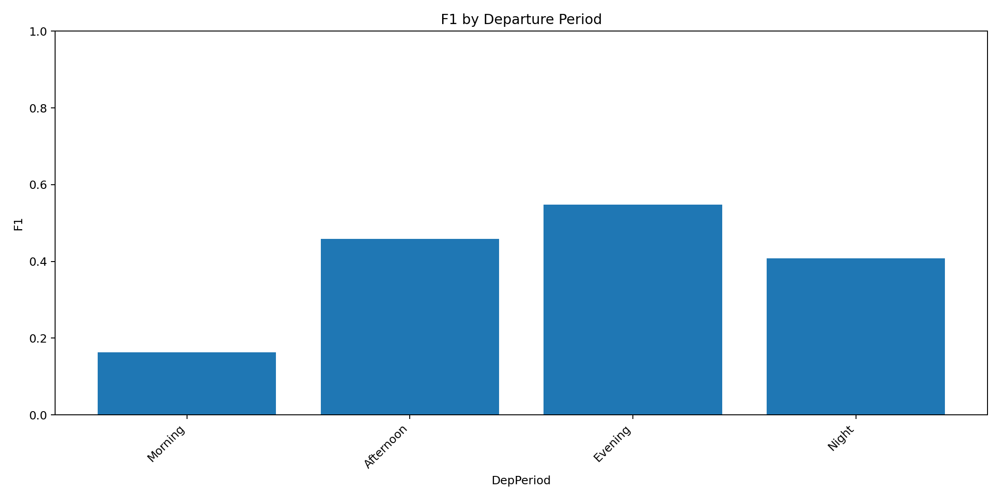
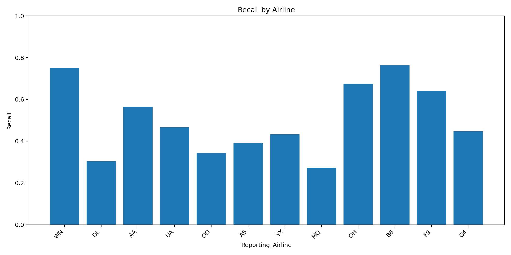
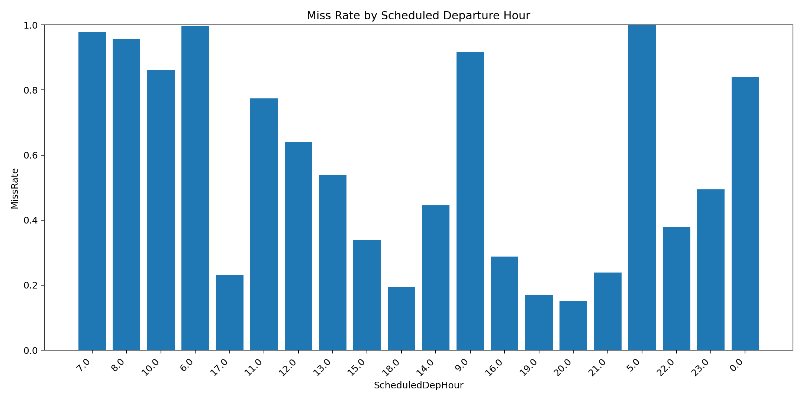
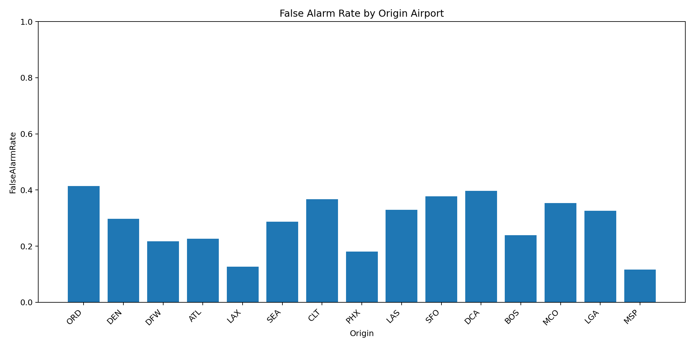
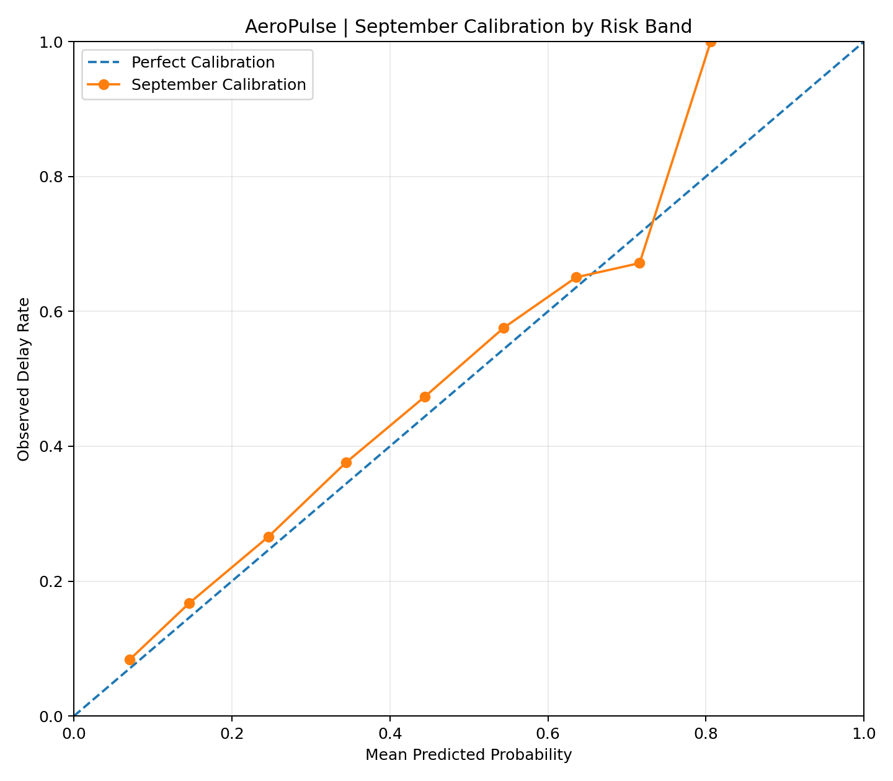

# AeroPulse ✈️
### U.S. Flight Delay Prediction & Operational Intelligence

**Language:** 🇬🇧 English | [🇹🇷 Türkçe](README_TR.md)

An end-to-end data science project combining **statistical analysis, machine learning, explainable AI, probability calibration, and out-of-time validation** to predict departure delays across the United States.

**Tech Stack:** Python · Pandas · NumPy · Scikit-learn · XGBoost · SHAP · Matplotlib · Seaborn

---

## Project Overview

Flight delays create operational challenges for airlines, airports, and passengers. AeroPulse investigates whether scheduled flight information and historical patterns can predict departure delays of **15 minutes or more**.

Beyond model development, the project examines probability reliability, decision threshold optimization, model explainability, and performance differences across airlines, airports, and departure periods.

### Research Questions

- Can scheduled flight information predict departure delays of at least 15 minutes?
- How do Logistic Regression, Random Forest, and XGBoost compare?
- Which features contribute most to model predictions?
- Can probability calibration improve estimated delay risk?
- Does a model developed on August data generalize to September?
- How does predictive performance vary across operational segments?

---

## Dataset

**Source:** U.S. Department of Transportation — Bureau of Transportation Statistics (BTS)

**Dataset:** Airline On-Time Performance Data  
**Period:** August–September 2026

| Dataset | Completed Flights | Purpose |
|---|---:|---|
| August 2026 | 594,207 | Model development and internal evaluation |
| September 2026 | 563,591 | External temporal validation |
| **Total** | **1,157,798** | **Flights analyzed** |

Cancelled and diverted flights were excluded from the modeling datasets.

### Target Variable

`Delayed15` is a binary classification target:

- `0` — Departure delay below 15 minutes
- `1` — Departure delay of 15 minutes or more

### Predictive Features

**Temporal features**
- Day of week and weekend indicator
- Scheduled departure hour and departure period
- Cyclical time encoding (`HourSin`, `HourCos`)

**Flight characteristics**
- Reporting airline
- Origin and destination airports
- Log-transformed flight distance

Actual departure and arrival delays are **not used as predictors**, helping avoid direct target leakage.

---

## Methodology

The project follows a chronological machine learning workflow.

**1. Data preparation and exploratory analysis**

Raw BTS data were inspected, cleaned, and analyzed for missingness, flight status, delay distributions, airline patterns, airport characteristics, and departure-time effects.

**2. Feature engineering**

Scheduled and historical attributes were transformed into model-ready features, including categorical flight information and cyclical representations of departure time.

**3. Model development**

Three classification approaches were investigated:

- Logistic Regression
- Random Forest
- XGBoost

XGBoost was selected for the final calibration and external validation workflow.

**4. Model explainability**

Feature importance, SHAP analysis, and ablation experiments were used to investigate the contribution of different predictors.

**5. Probability calibration**

Original XGBoost probabilities were compared with sigmoid and isotonic calibration. **Sigmoid calibration** was selected for the final model.

**6. Decision threshold optimization**

The classification threshold was selected using August validation data.

**Final decision threshold: `0.253331`**

This threshold was applied to September data without being re-optimized on September outcomes.

**7. External validation and robustness**

The final model was evaluated on a subsequent month, with subgroup analyses across airlines, airports, departure periods, scheduled hours, dates, and predicted risk bands.

---

## Chronological Data Split

| Partition | Period | Purpose |
|---|---|---|
| Training | August 1–20, 2026 | Model fitting |
| Validation | August 21–25, 2026 | Calibration and threshold selection |
| Internal test | August 26–31, 2026 | Internal performance evaluation |
| External validation | September 1–30, 2026 | Out-of-time evaluation |

**Methodological note:** The August validation partition was used for both probability calibration and threshold selection. September provides the independent temporal evaluation.

---

## Final Model Performance

### September 2026 — External Validation

The final calibrated XGBoost model was evaluated on **563,591 completed flights**.

| Metric | Result |
|---|---:|
| **ROC-AUC** | **0.7142** |
| **PR-AUC** | **0.4249** |
| **F1-score** | **0.4588** |
| Precision | 0.3988 |
| Recall | 0.5401 |
| Accuracy | 0.7094 |
| **Brier Score** | **0.1577** |
| Log Loss | 0.4861 |
| Decision Threshold | 0.253331 |

**Observed September delay rate:** 22.81%

### Confusion Matrix

| Actual / Predicted | On Time | Delayed |
|---|---:|---:|
| On Time | 330,366 | 104,667 |
| Delayed | 59,120 | 69,438 |

At the selected threshold, the model detected approximately **54% of delayed flights**. This detection rate comes with a substantial number of false-positive delay alerts, illustrating the operational trade-off between recall and precision.

---

## Key Findings

### 1. Departure Time Is a Major Predictor

XGBoost gain-based feature importance highlighted:

- `HourSin`: approximately **45.24%**
- `DepPeriod`: approximately **27.61%**

These values reflect model importance, not causal effects.

### 2. Delay Risk Changes Throughout the Day

| Departure Period | Observed Delay Rate | Model Recall |
|---|---:|---:|
| Morning | 12.95% | 10.50% |
| Afternoon | 27.37% | 56.15% |
| Evening | 34.62% | 80.48% |
| Night | 22.23% | 57.12% |

Evening flights showed the highest observed delay rate. The model also detected a considerably larger proportion of evening delays than morning delays.

### 3. Performance Varies by Airline

Selected September results:

| Airline | Delay Rate | Recall |
|---|---:|---:|
| Southwest (WN) | 31.64% | 75.02% |
| Delta (DL) | 16.94% | 30.33% |
| American (AA) | 26.97% | 56.50% |
| United (UA) | 20.04% | 46.66% |
| JetBlue (B6) | 25.80% | 76.43% |

These differences demonstrate why overall performance metrics should be complemented by subgroup-level evaluation.

### 4. Calibration Improves Probability Quality

The final model achieved a September **Brier Score of 0.1577**.

Risk-band analysis nevertheless identified groups where predicted delay probabilities were lower than observed delay frequencies. Good overall calibration does not imply perfect calibration for every subgroup.

### 5. Temporal Validation Matters

Evaluating the August-developed model on September flights provides evidence of short-term generalization. Performance across additional seasons and years remains an open research question.

---

## Visualizations

### Departure Period Performance



### Airline-Level Recall



### Hourly Miss Rate



### Origin Airport False Alarm Rate



### September Probability Calibration



---

## Model Integrity & Reproducibility

A dedicated integrity audit evaluated feature schemas, missing values, temporal boundaries, category handling, probability reproducibility, threshold consistency, and artifact integrity.

| Audit Status | Checks |
|---|---:|
| **PASS** | **22** |
| FAIL | 0 |
| REVIEW | 3 |

Regenerated September predictions matched the saved probabilities with a reported maximum absolute difference of **0.0000000000**.

Three review flags were retained for transparency. These should be considered alongside the project's methodological limitations.

---

## Repository Structure

```text
AeroPulse/
├── 01_initial_eda.py
├── 02_data_cleaning.py
├── 03_exploratory_analysis.py
├── 04_statistical_analysis.py
├── 04b_missingness_diagnostics.py
├── 05_feature_engineering.py
├── 06_logistic_regression.py
├── 06b_threshold_optimization.py
├── 07_tree_models.py
├── 08_feature_importance.py
├── 08b_shap_analysis.py
├── 09_ablation_study.py
├── 10_model_calibration.py
├── 10b_probability_calibration.py
├── 11_september_validation.py
├── 12_september_preprocessing.py
├── 13_external_validation.py
├── 14_threshold_validation.py
├── 15_model_robustness.py
├── 16_model_integrity.py
├── 17_final_report.py
├── outputs/
│   ├── calibration/
│   ├── experiments/
│   ├── explainability/
│   └── external_validation/
├── robustness/
│   ├── airline_recall.png
│   ├── departure_period_f1.png
│   ├── hourly_miss_rate.png
│   └── origin_false_alarm_rate.png
├── final_report/
│   ├── AeroPulse_Final_Report.md
│   ├── AeroPulse_Executive_Summary.md
│   ├── final_metrics.csv
│   ├── final_report_manifest.json
│   └── figures/
│       └── september_risk_calibration.png
├── README.md
├── README_TR.md
├── requirements.txt
└── .gitignore
```

The repository contains the published scripts and selected analysis artifacts. Raw BTS datasets and large intermediate files are not included.

---

## Installation

Clone the repository:

```bash
git clone https://github.com/busrasariofficial/AeroPulse.git
cd AeroPulse
```

Create a virtual environment:

```bash
python -m venv venv
```

Activate it on Windows:

```bash
venv\Scripts\activate
```

Install dependencies:

```bash
pip install -r requirements.txt
```

**Data requirement:** Download the original BTS datasets separately and place them in the expected local data directories.

To reproduce the full analysis, execute the numbered Python scripts in the appropriate order and generate the intermediate artifacts required by later stages.

---

## Limitations

- The analysis covers only two consecutive months.
- Calibration and threshold optimization share the August validation period.
- Class imbalance affects precision, recall, and threshold trade-offs.
- Model performance varies across airlines, airports, and departure periods.
- Some September airport categories were absent from the August reference data.
- Real-time weather and air traffic congestion are not included.
- The model is a research prototype, not a production-ready operational system.
- Predictive associations should not be interpreted as causal relationships.

---

## Future Improvements

- Multi-year and seasonal temporal validation
- Integration of weather and airport congestion data
- More detailed subgroup probability calibration
- Model drift monitoring
- Deployment as a prediction service

---

## Technical Reports

- [Final Technical Report](final_report/AeroPulse_Final_Report.md)
- [Executive Summary](final_report/AeroPulse_Executive_Summary.md)
- [Verified September Metrics](final_report/final_metrics.csv)

---

## Author

**Büşra Sarı**  
Statistics Graduate | Data Analytics & Machine Learning

[GitHub Profile](https://github.com/busrasariofficial)

*Developed as an independent data science portfolio project.*
