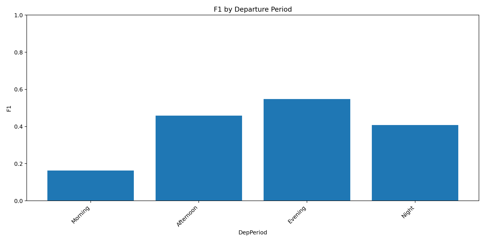
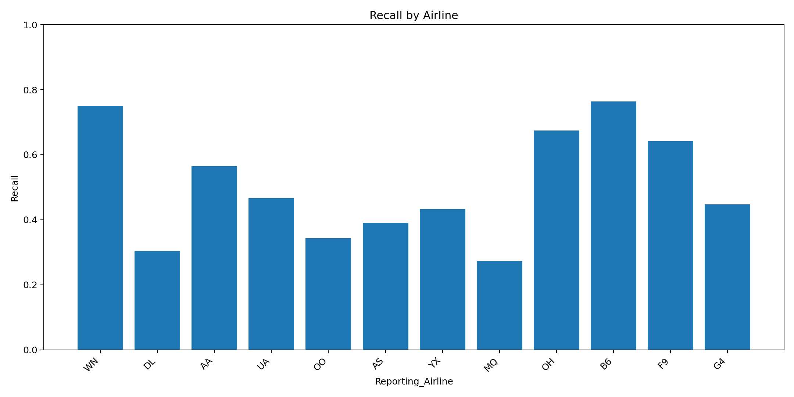
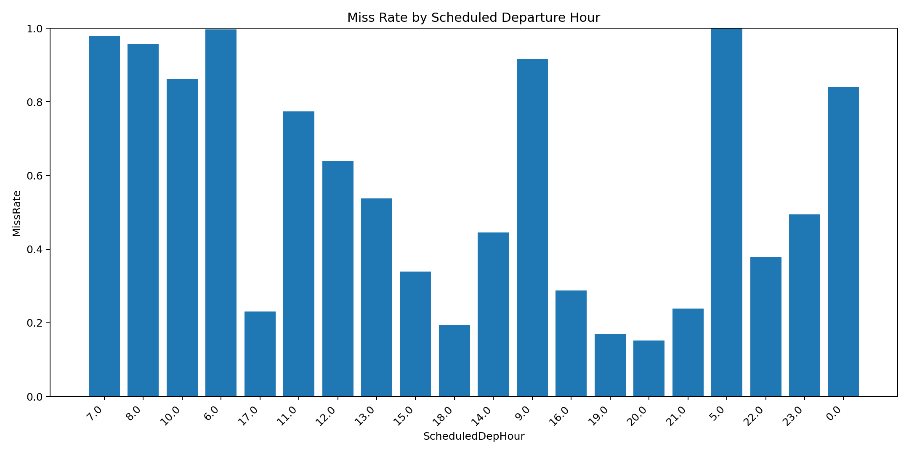
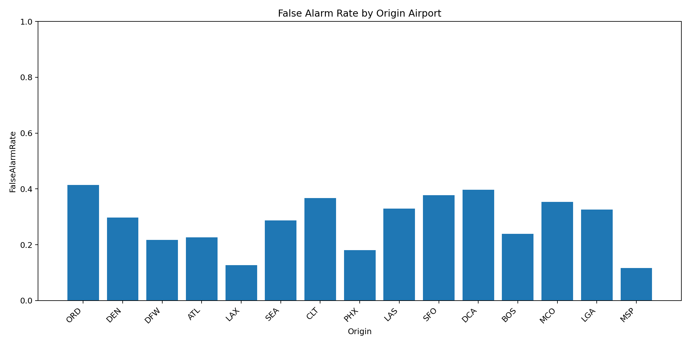
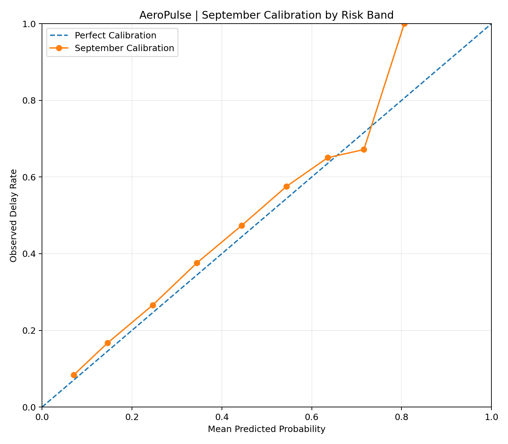

# AeroPulse ✈️
### ABD Uçuş Gecikmesi Tahmini ve Operasyonel Analiz

**Dil:** 🇹🇷 Türkçe | [🇬🇧 English](README.md)

ABD'deki uçuş gecikmelerini tahmin etmek amacıyla **istatistiksel analiz, makine öğrenmesi, açıklanabilir yapay zekâ, olasılık kalibrasyonu ve zamansal doğrulama** yöntemlerini bir araya getiren uçtan uca veri bilimi projesi.

**Teknolojiler:** Python · Pandas · NumPy · Scikit-learn · XGBoost · SHAP · Matplotlib · Seaborn

---

## Proje Hakkında

Uçuş gecikmeleri, havayolu şirketleri, havalimanları ve yolcular açısından önemli operasyonel sorunlar oluşturmaktadır.

AeroPulse, planlanan uçuş bilgileri ve geçmiş uçuş örüntülerinden yararlanarak **15 dakika ve üzerindeki kalkış gecikmelerini** tahmin etmeyi amaçlamaktadır.

Proje yalnızca bir sınıflandırma modeli geliştirmekle sınırlı değildir. Aynı zamanda tahmin olasılıklarının güvenilirliğini, karar eşiklerini, modelin açıklanabilirliğini ve farklı operasyonel gruplardaki performansını değerlendirmektedir.

### Araştırma Soruları

- Planlanan uçuş bilgileriyle 15 dakika ve üzerindeki gecikmeler tahmin edilebilir mi?
- Logistic Regression, Random Forest ve XGBoost modelleri nasıl karşılaştırılabilir?
- Tahminlerde hangi değişkenler öne çıkmaktadır?
- Olasılık kalibrasyonu tahmin edilen riskleri iyileştirebilir mi?
- Ağustos verileriyle geliştirilen model Eylül ayında da başarılı olabilir mi?
- Model performansı havayolu, havalimanı ve kalkış saatine göre nasıl değişmektedir?

---

## Veri Seti

**Kaynak:** ABD Ulaştırma Bakanlığı — Bureau of Transportation Statistics (BTS)

**Veri seti:** Airline On-Time Performance Data  
**Dönem:** Ağustos–Eylül 2026

| Veri Seti | Tamamlanmış Uçuş | Kullanım Amacı |
|---|---:|---|
| Ağustos 2026 | 594.207 | Model geliştirme ve iç değerlendirme |
| Eylül 2026 | 563.591 | Dış dönem doğrulaması |
| **Toplam** | **1.157.798** | **Analiz edilen uçuşlar** |

İptal edilen ve başka havalimanına yönlendirilen uçuşlar modelleme veri setlerinden çıkarılmıştır.

### Hedef Değişken

`Delayed15` ikili sınıflandırma değişkenidir:

- `0` — Kalkış gecikmesi 15 dakikadan az
- `1` — Kalkış gecikmesi 15 dakika veya daha fazla

### Tahmin Değişkenleri

**Zamansal değişkenler**
- Haftanın günü ve hafta sonu göstergesi
- Planlanan kalkış saati ve kalkış zaman dilimi
- Döngüsel saat dönüşümleri (`HourSin`, `HourCos`)

**Uçuş özellikleri**
- Havayolu şirketi
- Kalkış ve varış havalimanları
- Logaritmik dönüşüm uygulanmış uçuş mesafesi

Gerçekleşmiş kalkış ve varış gecikmeleri tahmin değişkeni olarak kullanılmamıştır. Böylece doğrudan hedef değişken sızıntısından kaçınılmıştır.

---

## Metodoloji

### 1. Veri Hazırlama ve Keşifsel Analiz

Ham BTS verileri incelenmiş; veri temizleme, eksik değer analizi, uçuş durumu kontrolleri, gecikme dağılımları ve havayolu-havalimanı bazlı analizler gerçekleştirilmiştir.

### 2. Özellik Mühendisliği

Planlanan uçuş bilgileri modellemeye uygun hâle getirilmiş, kategorik değişkenler ve döngüsel kalkış saati özellikleri oluşturulmuştur.

### 3. Makine Öğrenmesi

Üç sınıflandırma yaklaşımı incelenmiştir:

- Logistic Regression
- Random Forest
- XGBoost

Nihai kalibrasyon ve dış dönem doğrulama aşamalarında **XGBoost** tercih edilmiştir.

### 4. Açıklanabilir Yapay Zekâ

Modelin tahmin davranışını incelemek amacıyla özellik önem analizi, SHAP ve ablation study (değişken grubu çıkarma analizi) uygulanmıştır.

### 5. Olasılık Kalibrasyonu

Orijinal XGBoost olasılıkları, sigmoid ve isotonic kalibrasyon yöntemleriyle karşılaştırılmıştır.

Nihai değerlendirme için **sigmoid kalibrasyonu** seçilmiştir.

### 6. Karar Eşiği Optimizasyonu

Sınıflandırma eşiği Ağustos doğrulama verileri üzerinden belirlenmiştir.

**Nihai karar eşiği: `0.253331`**

Bu eşik, Eylül sonuçları kullanılarak yeniden optimize edilmeden uygulanmıştır.

### 7. Dış Dönem Doğrulaması ve Sağlamlık Analizi

Ağustos ayında geliştirilen model, Eylül 2026 uçuşları üzerinde değerlendirilmiştir.

Ayrıca havayolu, havalimanı, kalkış zaman dilimi, saat, tarih ve tahmin edilen risk gruplarına göre alt grup analizleri yapılmıştır.

---

## Zamansal Veri Ayrımı

| Veri Bölümü | Dönem | Amaç |
|---|---|---|
| Eğitim | 1–20 Ağustos 2026 | Model eğitimi |
| Doğrulama | 21–25 Ağustos 2026 | Kalibrasyon ve eşik seçimi |
| İç test | 26–31 Ağustos 2026 | İç performans değerlendirmesi |
| Dış doğrulama | 1–30 Eylül 2026 | Zamansal genelleme testi |

**Metodolojik not:** Ağustos doğrulama verisi hem kalibrasyon hem de karar eşiği seçiminde kullanılmıştır. Bağımsız dış dönem değerlendirmesi Eylül verileriyle gerçekleştirilmiştir.

---

## Nihai Model Performansı

### Eylül 2026 — Dış Dönem Doğrulaması

Kalibre edilmiş XGBoost modeli **563.591 tamamlanmış uçuş** üzerinde değerlendirilmiştir.

| Performans Metriği | Sonuç |
|---|---:|
| **ROC-AUC** | **0,7142** |
| **PR-AUC** | **0,4249** |
| **F1-Score** | **0,4588** |
| Precision (Kesinlik) | 0,3988 |
| Recall (Duyarlılık) | 0,5401 |
| Accuracy (Doğruluk) | 0,7094 |
| **Brier Score** | **0,1577** |
| Log Loss | 0,4861 |
| Karar Eşiği | 0,253331 |

**Eylül ayında gözlenen gecikme oranı:** %22,81

### Karmaşıklık Matrisi (Confusion Matrix)

| Gerçek / Tahmin | Zamanında | Gecikmeli |
|---|---:|---:|
| Zamanında | 330.366 | 104.667 |
| Gecikmeli | 59.120 | 69.438 |

Model, seçilen eşikte geciken uçuşların yaklaşık **%54'ünü** tespit etmiştir.

Bununla birlikte yanlış gecikme uyarılarının sayısı da yüksektir. Bu sonuç, gecikmeleri yakalama başarısı ile yanlış alarm oranı arasındaki dengeyi göstermektedir.

---

## Önemli Bulgular

### 1. Kalkış Saati Güçlü Bir Tahmin Değişkenidir

XGBoost gain tabanlı özellik önem analizinde zamansal değişkenler öne çıkmıştır:

- `HourSin`: yaklaşık **%45,24**
- `DepPeriod`: yaklaşık **%27,61**

Bu değerler model içindeki önem düzeylerini göstermektedir; nedensel etki olarak yorumlanmamalıdır.

### 2. Gecikme Riski Gün İçinde Değişmektedir

| Kalkış Dönemi | Gerçek Gecikme Oranı | Model Recall |
|---|---:|---:|
| Sabah | %12,95 | %10,50 |
| Öğleden Sonra | %27,37 | %56,15 |
| Akşam | %34,62 | %80,48 |
| Gece | %22,23 | %57,12 |

En yüksek gözlenen gecikme oranı akşam uçuşlarında gerçekleşmiştir.

Model, seçilen eşikte akşam uçuşlarındaki gecikmeleri sabah uçuşlarına göre çok daha yüksek oranda yakalamaktadır.

### 3. Havayolları Arasında Performans Farkları Bulunmaktadır

Seçilmiş Eylül sonuçları:

| Havayolu | Gecikme Oranı | Recall |
|---|---:|---:|
| Southwest (WN) | %31,64 | %75,02 |
| Delta (DL) | %16,94 | %30,33 |
| American (AA) | %26,97 | %56,50 |
| United (UA) | %20,04 | %46,66 |
| JetBlue (B6) | %25,80 | %76,43 |

Bu farklılıklar, modelin yalnızca genel performans metrikleriyle değil, alt gruplar bazında da değerlendirilmesi gerektiğini göstermektedir.

### 4. Olasılık Kalibrasyonu

Nihai modelin Eylül Brier Score değeri **0,1577** olarak hesaplanmıştır.

Risk grubu analizlerinde bazı grupların tahmin edilen olasılıklarının gerçekleşen gecikme oranlarından düşük kaldığı gözlemlenmiştir.

Bu nedenle genel kalibrasyon performansı, bütün alt gruplarda kusursuz tahmin yapıldığı anlamına gelmemektedir.

### 5. Zamansal Doğrulamanın Önemi

Modelin Ağustos ayında geliştirilip Eylül ayında değerlendirilmesi, kısa dönemli zamansal genelleme açısından ek kanıt sunmaktadır.

Farklı mevsimler ve yıllardaki performans ise henüz değerlendirilmemiştir.

---

## Görselleştirmeler

### Kalkış Dönemine Göre Model Performansı



### Havayolu Bazında Recall



### Saatlik Kaçırılan Gecikmeler



### Havalimanı Bazında Yanlış Alarm Analizi



### Eylül Olasılık Kalibrasyonu



---

## Model Bütünlüğü ve Tekrarlanabilirlik

Modelin güvenilirliğini değerlendirmek amacıyla ayrı bir bütünlük denetimi gerçekleştirilmiştir.

Denetimde veri şeması, eksik değerler, zamansal ayrım, özellik mühendisliği, kategori değişimleri, tahminlerin yeniden üretilebilirliği ve karar eşiği tutarlılığı incelenmiştir.

| Denetim Durumu | Kontrol Sayısı |
|---|---:|
| **PASS** | **22** |
| FAIL | 0 |
| REVIEW | 3 |

Eylül tahminleri yeniden üretildiğinde kaydedilmiş olasılıklarla maksimum mutlak fark **0,0000000000** olarak raporlanmıştır.

Üç inceleme kaydı, metodolojik şeffaflık amacıyla korunmuştur.

---

## GitHub Proje Yapısı

```text
AeroPulse/
├── 01_initial_eda.py
├── 02_data_cleaning.py
├── 03_exploratory_analysis.py
├── 04_statistical_analysis.py
├── 04b_missingness_diagnostics.py
├── 05_feature_engineering.py
├── 06_logistic_regression.py
├── 06b_threshold_optimization.py
├── 07_tree_models.py
├── 08_feature_importance.py
├── 08b_shap_analysis.py
├── 09_ablation_study.py
├── 10_model_calibration.py
├── 10b_probability_calibration.py
├── 11_september_validation.py
├── 12_september_preprocessing.py
├── 13_external_validation.py
├── 14_threshold_validation.py
├── 15_model_robustness.py
├── 16_model_integrity.py
├── 17_final_report.py
├── outputs/
│   ├── calibration/
│   ├── experiments/
│   ├── explainability/
│   └── external_validation/
├── robustness/
│   ├── airline_recall.png
│   ├── departure_period_f1.png
│   ├── hourly_miss_rate.png
│   └── origin_false_alarm_rate.png
├── final_report/
│   ├── AeroPulse_Final_Report.md
│   ├── AeroPulse_Executive_Summary.md
│   ├── final_metrics.csv
│   ├── final_report_manifest.json
│   └── figures/
│       └── september_risk_calibration.png
├── README.md
├── README_TR.md
├── requirements.txt
└── .gitignore
```

Depoda Python analiz kodları ve seçilmiş çıktı dosyaları bulunmaktadır. Ham BTS verileri ve büyük ara dosyalar GitHub'a eklenmemiştir.

---

## Kurulum

Projeyi klonla:

```bash
git clone https://github.com/busrasariofficial/AeroPulse.git
cd AeroPulse
```

Sanal ortam oluştur:

```bash
python -m venv venv
```

Windows üzerinde etkinleştir:

```bash
venv\Scripts\activate
```

Bağımlılıkları yükle:

```bash
pip install -r requirements.txt
```

**Veri gereksinimi:** Orijinal BTS veri setleri ayrıca indirilmeli ve beklenen yerel veri klasörlerine yerleştirilmelidir.

Analizleri yeniden çalıştırmak için numaralandırılmış Python dosyaları uygun sırayla yürütülmeli ve sonraki aşamalarda kullanılan ara çıktılar oluşturulmalıdır.

---

## Projenin Sınırlamaları

- Çalışma yalnızca iki ardışık ayı kapsamaktadır.
- Kalibrasyon ve eşik optimizasyonu aynı Ağustos doğrulama dönemini kullanmaktadır.
- Sınıf dengesizliği precision, recall ve eşik seçimini etkilemektedir.
- Havayolu, havalimanı ve kalkış dönemleri arasında performans farklılıkları vardır.
- Bazı Eylül havalimanı kategorileri Ağustos referans verisinde bulunmamaktadır.
- Gerçek zamanlı hava durumu ve hava trafik yoğunluğu kullanılmamıştır.
- Model, üretim ortamına hazır bir sistem değil, araştırma ve portföy prototipidir.
- Tahminsel ilişkiler nedensellik kanıtı değildir.

---

## Gelecekte Yapılabilecek Geliştirmeler

- Çok yıllı ve mevsimsel zamansal doğrulama
- Hava durumu ve havalimanı yoğunluğu verilerinin eklenmesi
- Alt gruplar için ayrıntılı olasılık kalibrasyonu
- Veri kayması ve model performansı izleme
- Tahmin servisinin geliştirilmesi

---

## Teknik Raporlar

- [İngilizce Final Teknik Rapor](final_report/AeroPulse_Final_Report.md)
- [Yönetici Özeti](final_report/AeroPulse_Executive_Summary.md)
- [Doğrulanmış Eylül Metrikleri](final_report/final_metrics.csv)

---

## Geliştirici

**Büşra Sarı**  
İstatistik Mezunu | Veri Analitiği ve Makine Öğrenmesi

[GitHub Profilim](https://github.com/busrasariofficial)

*Bağımsız bir veri bilimi portföy projesi olarak geliştirilmiştir.*
